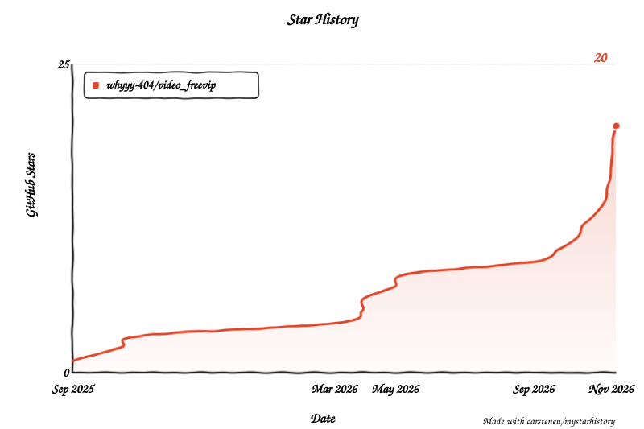

  

# 自嘲熊请你看电影 - 404小岛  
# 🎬 VIP追剧神器脚本
**多接口智能解析 · 自动下一集 · 去除插播广告 · 长期维护更新 · 完全免费**

**如果这个项目对你有帮助，欢迎点个 ⭐ Star 支持一下，开源不易，您的支持对我真的很重要！**

如果💕有帮助到你 投喂渠道：[微信赞赏](https://github.com/521-baby/521-baby/blob/main/DONATE.md) or [支付宝](https://github.com/521-baby/521-baby/blob/main/DONATE2.md)

[项目概述](#-项目概述) · [主要特性](#-主要特性) · [快速开始](#-快速开始) · [解析操作](#-解析操作详解) · [找片找站](#-找片与找站v350-新增) · [接口清单](#-接口清单) · [常见问题](#-常见问题与解决) · [致谢](#-致谢与参考来源) · [GitHub 仓库](https://github.com/whyyy-404/video_freevip)

> **本项目完全免费开源。** 如果你是在任何地方「花钱买到」的，说明你被骗了，请立即退款。
> 任何收费版本均为二次打包的诈骗版本，与本项目无关。

## 💖 赞助商

<table>
<tr>
<td width="180" align="center" valign="middle">
  <a href="https://zip0.com/?r=0LUAMJ">
    
    <b>ZIP0</b>
  </a>
</td>
<td valign="middle">
  <b><a href="https://zip0.com/?r=0LUAMJ">ZIP0</a></b>&nbsp;是在线影视聚合搜索与播放站，
  一次查询多个公开来源，覆盖电影 / 短剧 / 电视剧 / 综艺 / 纪录片 / 体育，另有看电视、听广播、听音乐与小游戏。
  (❤️ ω ❤️) 作者力推，非常推荐。┏ (゜ω゜)=👉 本行是作者的邀请链接，通过它访问就是对项目的支持。
</td>
</tr>
<tr>
<td width="180" align="center" valign="middle">
  <a href="https://api-zeno.com/zh-CN/auth/register?ref=abc9818807">
    
    <b>api-zeno</b>
  </a>
</td>
<td valign="middle">
  <b><a href="https://api-zeno.com/zh-CN/auth/register?ref=abc9818807">api-zeno</a></b>&nbsp;是多模型 API 中转服务平台，兼容 OpenAI SDK，支持 GPT、Claude、Gemini、Grok、DeepSeek 等模型，并提供 AI 创作系统。优势：售后团队非常完整的，售后有保障，优势在 48-220额度的汇率 ai创作系统集合 公司运营更稳定不跑路 有几户24h的售后，劣势 有日限额 知名度不高
</td>
</tr>
</table>

---
## 📖 项目概述

这是一个**强大的用户脚本**，旨在帮助用户免费观看各大视频网站的 VIP 内容。通过集成多个**第三方解析接口** 以及 **采集源**，**独家JSON接口**，该脚本能够绕过视频网站的会员限制，让用户享受**免费**的视频观看体验。

> ***温馨提示**：本脚本使用的解析接口全部收集自互联网。解析出的视频质量（如清晰度）取决于接口提供方，本脚本无法控制或保证。*

### 📁 文件

| 文件 | 内容 |
| --- | --- |
| [vip-video.user.js](https://github.com/whyyy-404/video_freevip/blob/main/vip-video.user.js) | 主脚本：VIP 解析 + 采集源 + 导航 + 自动下一集。**已内嵌** [M3u8Filter.user.js](https://github.com/whyyy-404/video_freevip/blob/main/M3u8Filter.user.js)，采集源播放和解析接口播放**都生效** |
| [M3u8Filter.user.js](https://github.com/whyyy-404/video_freevip/blob/main/M3u8Filter.user.js) | M3U8 广告过滤器脚本：6 种删除策略 + 2 种修复。**独立脚本**，`@match *://*/*` 且无 `@noframes`，装了就自动注入所有页面和 iframe。主脚本已内嵌，一般不需要单独装；接口站点有严格 CSP 时可用它兜底 |
| [README.md](https://github.com/whyyy-404/video_freevip/blob/main/README.md) | 项目介绍、快速开始、常见问题（本文件）|
| [M3u8Filter-README.md](https://github.com/whyyy-404/video_freevip/blob/main/M3u8Filter-README.md) | M3U8 过滤器脚本的完整说明 |

### 访客人数：

### 🌟 主要特性

- **20 条实测解析接口**：内嵌 / 弹窗双模式，随点随换
- **53 条采集源**：按剧名搜片，剧集按线路分组，页内直接播放
- **自动追剧，自动下一集**：设好默认接口，打开视频自动解析；采集源播放自动下一集
- **一键搜全部**：并发搜所有采集源，有结果的按钮实时变绿并显示命中数
- **去除插播广告**：M3U8 过滤器自动删除广告片段（采集源播放 + 解析接口播放都生效）
- **多条站点导航**：同色 = 同一家，一键直达
- **各大平台**：爱奇艺 / 腾讯 / 优酷 / 芒果 / B站 / 搜狐 / 乐视
- **移动端自适应**：手机 / 平板自动适配 16:9 播放比例，点浮标即可开关面板
- **完全自定义**：批量添加自定义接口、面板样式（颜色宽度等等）、快捷键

---

## 📌 使用指南

## ①. 快速开始

### 0. 安装用户脚本管理器（若已安装，注意下面的⚠️）

<b>▶ 脚本猫 (ScriptCat) — 各浏览器安装链接</b>

- **官方网站**：[https://scriptcat.org/](https://scriptcat.org/)
- Chrome：[点击安装 ScriptCat for Chrome](https://chrome.google.com/webstore/detail/scriptcat/lhplgjmbpnjgjmpbokdjpcbbekifcmli)
- Firefox：[点击安装 ScriptCat for Firefox](https://addons.mozilla.org/zh-CN/firefox/addon/scriptcat/)
- Edge：[点击安装 ScriptCat for Edge](https://microsoftedge.microsoft.com/addons/detail/scriptcat/llhcdfddnmmcmlbdennkpdnlnbgbmfak)

<b>▶ 油猴 (Tampermonkey) — 各浏览器安装链接</b>

- **官方网站**：[https://www.tampermonkey.net/](https://www.tampermonkey.net/)
- Chrome：[点击安装 Tampermonkey for Chrome](https://chrome.google.com/webstore/detail/tampermonkey/dhdgffkkebhmkfjojejmpbldmpobfkfo)
- Firefox：[点击安装 Tampermonkey for Firefox](https://addons.mozilla.org/en-US/firefox/addon/tampermonkey/)
- Edge：[点击安装 Tampermonkey for Edge](https://microsoftedge.microsoft.com/addons/detail/tampermonkey/iikmkjmpaadaobahmlepeloendndfphd)
- Safari：[点击安装 Tampermonkey for Safari](https://apps.apple.com/us/app/tampermonkey/id1482490089)

#### ⚠️(╬▔皿▔)╯脚本管理器权限提醒
安装 `Tampermonkey / 篡改猴`、`Violentmonkey` 等脚本管理器后，**请手动检查并开启「允许用户脚本」或类似权限**，否则脚本可能不会运行。

<b>常见检查方法如下（点开查看）</b>

1. 打开当前浏览器的 `扩展` 或 `插件` 页面
2. 找到你已安装的脚本管理器（如 `Tampermonkey / 脚本猫`）
3. 打开该扩展的详情页
4. 检查是否存在以下类似选项，并确认已开启：
    - **允许用户脚本**
    - **允许此扩展运行用户脚本**
    - **允许访问站点数据**
    - **允许在此网站上运行**

**🚨(╯‵□′)╯炸弹！•••*～ 请默认把这一步当成必做项。**
如果这些权限没有开启，脚本即使安装成功，也可能完全不运行。

### 1. 安装脚本 及 使用方法
1. **安装脚本**：在 [Tampermonkey](https://www.tampermonkey.net/) 中安装[本油猴脚本](https://greasyfork.org/zh-CN/scripts/531324-vip%E8%BF%BD%E5%89%A7%E7%A5%9E%E5%99%A8-free-%E6%94%AF%E6%8C%81%E5%A4%9A%E5%B9%B3%E5%8F%B0) 或 [脚本猫](https://scriptcat.org/) 中安装 [本脚本猫脚本](https://scriptcat.org/zh-CN/script-show-page/3299)
2. **打开视频网站**：访问爱奇艺、腾讯视频、bilibili 等支持的平台
3. **找到浮标**：页面左侧三个**gif**浮标——**主浮标（自嘲熊）**、**自动解析开关（发呆/跳）**、**公告（猫猫虫）**；也可用 **Alt+V**，或脚本管理器菜单 **「🎬 VIP解析窗口」**，如下图所示：
4. **选择接口和模式**：悬停主浮标打开面板（**手机端点按**）；优先试靠前的 **「TXNQ」「酥皮」「66网1」**；点接口右侧 **「内嵌/弹窗」** 可切换模式
5. **开始观看**：点选接口后解析播放

<b>⚠️ 如果脚本安装后没有生效，请优先检查（点开查看）</b>

1. 脚本管理器是否已**启用**
2. 脚本是否已成功安装并处于**开启状态**
3. 脚本管理器中是否已开启 **允许用户脚本** 或类似权限
4. 当前**网站**是否在脚本**支持范围内**
5. 是否有广告拦截器、隐私插件或浏览器设置阻止脚本运行

## ②. 解析操作详解
1. **手动解析**：
   - 打开**VIP视频解析**标签页
   - 鼠标悬停（**手机端点按**）左侧 **吃面的自嘲熊** 图标 或 **按 Alt+V** 呼出面板
   - 在面板上的 **VIP视频解析** 标签页，点击任意播放接口 **（推荐靠前的「TXNQ」「酥皮」「66网1」）**
   - 等待解析完成，开始播放
   - **提示**：点击接口名称右侧的"内嵌/弹窗"可切换播放模式

2. **自动解析**：
   - 点击右侧**自定义设置**标签页
   - 点击**自动解析设置**按钮（灰色按钮）
   - 在下拉列表中选择**默认解析接口**（推荐靠前接口）
   - 点击**保存**按钮确认设置
   - 点中间 **发呆熊/跳熊** 浮标开关（发呆=关，跳=开）
   - 自动生效，打开VIP视频会**自动解析播放**

3. **追剧切集**
   - 开启自动解析后，切集检测到地址变化会刷新；开启状态下会再自动解析新集

4. **关闭解析**
   - 内嵌时鼠标移动显示「×」，约 3 秒无操作后隐藏；点击关闭会刷新页面

## ③. 找片与找站（v3.5.0 新增）
1. **采集源找片**：切到 **采集源** 标签页 → 输入剧名 → 点任意一个采集源即可搜索
   - 改完剧名**再点一次同一个源**就是重新搜索
   - 命中多部时先列出片名让你挑；选定后剧集**按线路分组**展示
   - 点剧集即可在**页面播放器区直接播放**，不跳站
   - 悬停任意采集源可看到它的**接口地址**；「日常」那条悬停会列出**随机池里包含哪些源**
2. **站点导航**：切到 **导航** 标签页 → 点任意站点直达；同色 = 同一家
3. **搜索跳转**：部分站点支持用剧名拼好地址直接打开它的搜索结果页
   - ⚠️ 个别站第一次会先弹一次人工验证码，过了之后一般不用再输

## ④. 自定义与公告
- **自定义设置**标签：添加接口、面板样式、快捷键、自动解析设置
- **公告浮标**：使用说明 + **赞赏码** 觉得好用可以小额赞助一下额哦（づ￣3￣）づ╭❤️～
- **拖拽**：可拖主浮标 / 开关 / 公告调整整组位置，松手后 **跨域** 保存

## 🎯 接口清单

<b>20 条解析接口（点开查看）</b>

| 分组 | 接口 | 说明 |
| --- | --- | --- |
| 第一梯队 | TXNQ · 酥皮 · TXNQ2 | 实测最好用，排最前 |
| 有选集 | 云解析 · 臻享 · 无名小站 | 支持内嵌 / 弹窗 / 带选集全部模式 |
| 其余可用 | 麒麟1 · 789 · 邦宁 · M1907 | |
| 仅弹窗 | 66网1 · 66网2 · LX解析 | 排在最后 |

<b>53 条采集源（点开查看）</b>

| 分区 | 数量 | 说明 |
| --- | --- | --- |
| ✅ 可用 | 24 | 直连就能搜到 |
| ✅ 可用 · 自动换接口 | 6 | 内部会换接口重试 |
| ✅ 可用 · 稍慢 | 1 | |
| ✅ 可用 · 只能找新剧 | 1 | 老剧搜不到 |
| ⚠️ 可用，代理稍慢 | 5 | 需要走代理，稳定性一般 |
| 搜索跳转 | 15 | 跳到对方站自己搜 |
| 随机池 | 1 | 点「日常」随机挑一个 |

合计 **53 条**，其中 **37 条**可并发搜索。

<b>22 条站点导航（点开查看）</b>

切到 **导航** 标签页，点任意站点直达。同色 = 同一家（与解析接口、采集源共用一套颜色标记）。

---
## 📢 重要声明与须知
1. **接口来源：** 所有解析接口均来自公开网络，脚本作者不拥有这些接口的所有权。
2. **视频质量：** 解析出的视频质量（如清晰度、速度）取决于接口提供方，本脚本无法控制或保证。
3. **侵权问题：**
    - 如果某个解析接口存在侵权行为，请联系**该接口的提供方或站长**处理。
    - 本插件仅为免费发布的工具，不承担任何法律责任。
4. **广告警告：** 部分解析接口页面可能包含广告，**请大家切勿轻信广告内容**。请谨慎辨别！
   - 本脚本不会主动投放广告。
   - 第三方解析接口页面若出现广告、跳转、下载提示、伪装播放按钮，均与接口提供方有关。
5. **版权声明：** 本工具仅供学习和研究使用，请尊重版权，支持正版。建议在试用后购买正版会员支持内容创作者。

---

### 兼容性说明
- **浏览器支持**：Chrome、Firefox、Edge、Safari等主流浏览器
- **脚本管理器**：需要安装Tampermonkey、Violentmonkey或ScriptCat
- **网站适配**：支持爱奇艺、腾讯视频、优酷、芒果TV、B站等主流平台

### ⚠ 常见问题与解决

<b>1. 重音 / 音画不同步（基本不会）</b>

- **可能原因**：网络速度慢、视频源服务器压力大、解析接口负载高
- **解决方法**：刷新页面、切换其他接口、检查网络

<b>2. 解析失败</b>

- **可能原因**：视频链接格式不正确、解析接口暂时失效、网站更新了防护
- **解决方法**：确认链接完整、尝试其他接口、等待脚本更新

<b>3. 自嘲熊浮标不显示</b>

- **可能原因**：网络问题、脚本未开启、网站不在支持列表、浏览器插件冲突
- **解决方法**：更换网络、开启脚本（或 Alt+V 唤出）、检查支持列表、禁用其他插件

<b>4. 采集源搜不到</b>

- **可能原因**：该采集源自身失效、需要走代理、站点短期内不可用，或该源只能搜到近期更新的剧
- **解决方法**：换另一个采集源重试；或点「日常」让脚本随机换一个；过一段时间再试

<b>5. 自动解析无效</b>

先在设置里选接口并保存 → 开关为「跳熊/开」→ 刷新页面。

<b>6. 广告中解析后仍出原声</b>

请检查当前是否是最新版本（已加强原站媒体压制）；仍异常可反馈。

<b>7. 关闭后原片不播</b>

需刷新（关闭按钮会刷新）；因原容器 DOM 已清空。

---

## 🙏 使用反馈

**更新建议**：欢迎在 赞赏留言 或者 反馈处 或者 评论区 或者 wx 提交 ~~Bug~~ 报告 或 功能建议 或 优良接口

---

　　　          ┏┓　          　　┏┓
 　   ┏┛┻━━━┛┻┓
　　┃　　　　　　　 ┃
　　┃　　　━　　　 ┃
　　┃　┳┛　┗┳　┃
　　┃　　　　　　　 ┃
　　┃　　　┻　　　 ┃
　　┃　　　　　　　 ┃
　　┗━┓　　　┏━┛Codes are far away from bugs with the animal protecting
　　　　┃　　　┃    神兽保佑,代码无bug
　　　　┃　　　┃
　　　　┃　　　┗━━━┓
　　　　┃　　　　　 ┣┓
　　　　┃　　　　 ┏┛
　　　　┗┓┓┏━┳┓┏┛
　　　　　┃┫┫　┃┫┫
　　　　　┗┻┛　┗┻┛

---

## **🎬 享受VIP观影体验，从这一刻开始！** ✨
---

## 🤝 贡献指南

欢迎提交 Issue 和 PR。为减少来回沟通、提高处理效率，仓库已补充中文模板和基础自动化流程。

### 问题反馈
- 提交前请先阅读 [贡献与反馈指南](https://github.com/whyyy-404/video_freevip/blob/main/CONTRIBUTING.md)
- GitHub Issues 已区分为：`Bug 反馈`、`功能建议`、`站点兼容 / 解析源异常反馈`
- **请尽量提供完整视频页面 URL、浏览器 / 脚本管理器 / 系统环境、复现步骤，以及截图**
- **如果是解析问题，请明确具体解析源名称**

### Pull Request
- 提交 PR 时请尽量按仓库内置模板填写
- 说明改动背景、解决方案、兼容性影响和测试结果
- 如果改动涉及移动端、站点兼容或解析源逻辑，请明确写出影响范围

如需长期协作，请优先按照模板提交，维护成本会低很多。

---

## 🙏 致谢与参考来源

本项目非常感谢来自 [屏幕前的你](https://github.com/963540817) 大佬 的 Hub 以及各种强势功能，特此致谢。**（引用前提，拒绝商业化）**

参考项目：<https://github.com/963540817/dashu>

本脚本在其基础上所做的工作：

- **采集源清单**：逐条实测、剔除失效条目、按可用性重新分组，补充搜索 / 代理兜底 / 两步型取数逻辑
- **[M3U8 广告过滤](https://github.com/whyyy-404/video_freevip/blob/main/M3u8Filter.user.js)**：改用逐行解析、补充 ppvod 标记识别、增加日志与可测试接口。
  它有两种用法 —— ① 主脚本已内嵌，采集源播放和解析接口播放都自动生效，不用额外装；
  ② 接口站点有严格 CSP 挡住内联脚本时，把 [M3u8Filter.user.js](https://github.com/whyyy-404/video_freevip/blob/main/M3u8Filter.user.js) 单独装一遍兜底
  （脚本管理器的注入走扩展通道，不受 CSP 限制），详见 [M3u8Filter-README.md](https://github.com/whyyy-404/video_freevip/blob/main/M3u8Filter-README.md)

但**核心思路来自 dashu** —— 再次感谢。

如认为收录或署名方式仍有不妥，欢迎提 Issue 或直接联系，我会立即调整或移除。

---
## 📄 开源协议 (License)

本项目采用 [GPL License](https://www.gnu.org/licenses/gpl-3.0.txt) 开源协议。

- 保留原作者的版权声明；
- 衍生作品必须继续以 GPL-3.0 发布；
- 分发时需提供源代码或明确的获取方式；
- 对修改内容进行必要说明；
- 不得移除或篡改原许可信息。

## ⭐ Star History

> [!TIP]
> 如果本项目对您产生了帮助，或者您关注本项目的未来发展，请给项目 Star，这是我们维护这个开源项目的动力

<picture>
  <source media="(prefers-color-scheme: dark)" srcset="https://raw.githubusercontent.com/whyyy-404/video_freevip/star-history/assets/my-star-history/star-history-dark.svg">
  
</picture>

**温馨提示：** 好工具大家共享，请合理使用。请尊重版权，支持正版。本脚本仅供学习和研究使用，请在试用后购买正版会员支持您喜欢的内容创作者。